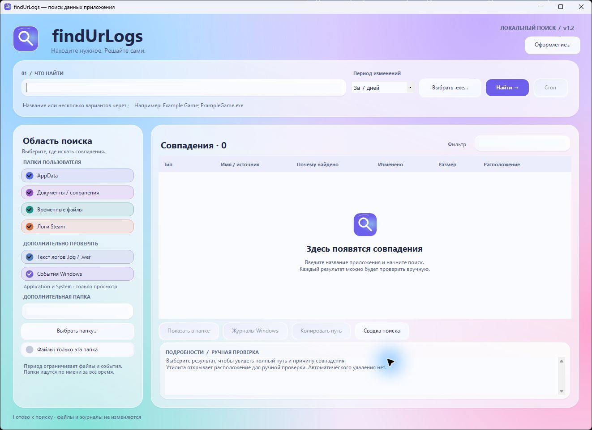
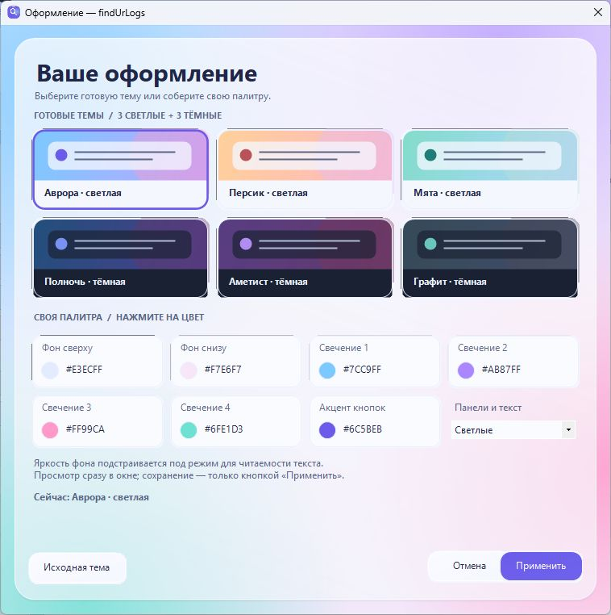
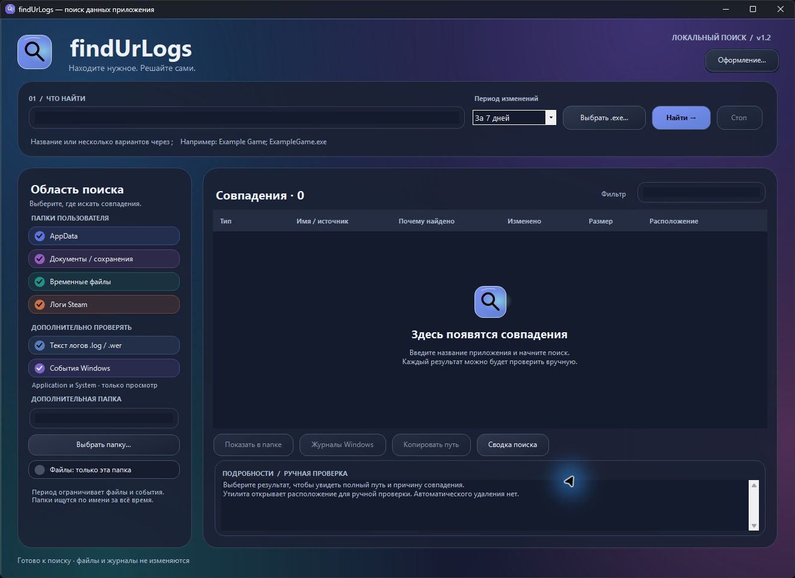

# findUrLogs 1.2.1

Утилита для Windows 11 x64: вводите название приложения, получаете список совпадений и открываете нужное расположение для ручной проверки. Ничего не удаляет и не изменяет в найденных файлах и журналах.

## Разработка с помощью ИИ

Проект создан при помощи ChatGPT / Codex: человек задавал идею, требования и направление дизайна, ИИ помог подготовить код, интерфейс и документацию. Это не официальный продукт OpenAI. Подробности — в AI_DISCLOSURE.md.

## Новый интерфейс

Светлый разноцветный фон, карточки с эффектом матового стекла, мягкие блики, округлые кнопки и цветные переключатели. Это визуальная стилизация в духе Liquid Glass; размытие содержимого других окон и эффекты преломления iOS не используются.

## Обновление 1.2.1: плавность окна

Ускорена отрисовка цветного фона при перемещении, изменении размера и разворачивании окна. Градиенты готовятся один раз для текущей темы в небольшой текстуре и быстро масштабируются при отрисовке. Текст, элементы управления и размеры панелей сохраняют обычное поведение. Подробности замера и проверки — в CHECKS.md.

## Оформление под себя

Нажмите **«Оформление…»** справа вверху. Доступны шесть пресетов:

| Светлые | Тёмные |
| --- | --- |
| Аврора | Полночь |
| Персик | Аметист |
| Мята | Графит |

Нажмите на готовую тему для предварительного просмотра. Для своей палитры выберите цвета фона сверху и снизу, четырёх свечений и акцента кнопок. Цвета можно задать в стандартном диалоге Windows, в том числе числовыми значениями RGB. Режим **«Панели и текст»** переключает светлые и тёмные поверхности. Яркость фона и цвет надписей на акцентных кнопках подстраиваются для читаемости.

- **«Применить»** сохраняет выбранную палитру для следующих запусков.
- **«Отмена»**, Escape или закрытие окна возвращают оформление, с которым окно было открыто.
- **«Исходная тема»** показывает «Аврору»; для сохранения этого сброса нажмите «Применить».

Настройки сохраняются в **findUrLogs.theme** рядом с исполняемым файлом. Это переносимая настройка этой копии программы: при переносе папки её можно взять с собой. Для сохранения нужна запись в папку программы. Запросы, пути к найденным файлам и результаты поиска в настройки не попадают. При некорректном файле оформления используется исходная тема; программа показывает сообщение в строке состояния. Файл прежней версии не требуется.

Смена темы не очищает запрос, результаты или выбранную строку.

## Запуск

Откройте **findUrLogs.exe** двойным щелчком. Установка и права администратора не нужны. Файл **findUrLogs.exe.config** оставьте рядом с программой. Требуется .NET Framework 4.8; Python и отдельный .NET SDK не нужны.

## Как пользоваться

1. Введите название. Если знаете разные варианты, разделите их точкой с запятой: `Example Game; ExampleGame; ExampleGame.exe`.
2. Либо нажмите **«Выбрать .exe…»**: имя файла без расширения добавится к поиску. Выбранная программа не запускается, её папка автоматически не сканируется. Если том отключён, введите известное имя вручную.
3. Укажите период: 24 часа, 7 дней, 30 дней или всё время. Для файлов используется дата последнего изменения, для событий — дата события. Это не фильтр по времени запуска приложения. Папки ищутся по имени независимо от даты.
4. Отметьте области поиска. В **«Доп. папка»** можно указать конкретную локальную папку. Флажок **«Файлы: только эта папка»** исключает остальные файловые области; чтение событий Windows задаётся отдельным флажком.
5. Нажмите **«Найти»**. Поиск можно остановить; уже найденные результаты останутся в списке.
6. Выберите результат. Внизу появятся полный путь и причина совпадения. **«Фильтр»** сужает уже найденный список, а не запускает новый поиск.
7. Для файла или папки нажмите **«Показать в папке»**: Проводник выделит объект. Двойной щелчок по файловому результату делает то же самое; сам файл не открывается и не запускается.
8. Для события текст доступен в нижней панели. **«Журналы Windows»** открывает обычный Просмотр событий. Перехода к конкретной записи автоматически нет: канал и номер записи указаны в результате.
9. Откройте **«Сводка поиска»**, чтобы увидеть количество проверок, пропуски и достигнутые ограничения.

Совпадение не является рекомендацией удалить файл. Найденная папка может содержать сохранения, настройки, скриншоты и другие нужные данные. Перед ручными изменениями закройте соответствующее приложение и сохраните нужные файлы отдельно. Утилита не управляет Корзиной и не выполняет удаление.

## Что проверяется

- Имена файлов и папок: AppData текущего пользователя (Local, Roaming, LocalLow), Документы, Saved Games, пользовательская временная папка, известная папка логов Steam, дополнительная выбранная папка.
- При включённом чтении текста: содержимое файлов `.log` и `.wer` размером до 2 МБ. Поддерживаются UTF-8, UTF-16 с BOM и системная ANSI. Содержимое файлов других форматов не исследуется.
- Локальные журналы Windows **Application** и **System**: текст сообщения, XML и источник, до 3 000 последних событий каждого журнала в выбранном периоде. Доступ только для чтения.

Название ищется как буквальная подстрока без учёта регистра. Несколько названий объединяются условием «ИЛИ». Маски и регулярные выражения не используются. Минимум 3 символа на название, максимум 8 названий.

## Ограничения

- До 500 результатов, 100 000 файлов, 30 000 папок, 12 уровней вложенности и примерно 120 секунд на поиск. Операция чтения может завершаться дольше; отмена выполняется между операциями. Уточняйте область и название при достижении лимитов.
- Суммарно читается до 100 МБ текста логов. Большие логи проверяются только по имени. Заблокированные или недоступные объекты пропускаются и учитываются в сводке.
- Ссылки, точки повторной обработки и офлайн-файлы пропускаются. Папки `.git`, `node_modules`, `.venv`, `venv`, `$Recycle.Bin`, `System Volume Information` и папка самой утилиты не сканируются. Сетевые пути и поиск по всему диску не поддерживаются.
- Поиск не определяет псевдонимы, Steam App ID, связь с лаунчером и принадлежность общих кэшей шейдеров. Содержимое ярлыков, двоичных кэшей, видеопамять, реестр, журнал Security, другие каналы событий и серверная история не исследуются.
- Отсутствие совпадений не доказывает отсутствие сведений о запуске. Найденное название может относиться к другому приложению.

## Обращение с данными

Программа не содержит удаления найденных данных, очистки журналов, изменения реестра, отключения защиты или функций отправки данных. Результаты и параметры поиска хранятся в памяти до закрытия; на диск сохраняется только оформление после нажатия «Применить». Собственный отчёт поиска на диск не записывается. Кнопка копирования помещает выбранное расположение в буфер обмена только по вашему нажатию.

Сама Windows и другое установленное ПО могут учитывать запуск утилиты, чтение файлов и открытие Проводника. Это инструмент поиска, а не средство незаметного запуска или гарантированного уничтожения данных.

## Исходный код

В папке **Source** находятся исходники C#, манифест и **Build.ps1** для повторной сборки встроенным компилятором .NET Framework. Сторонних библиотек нет. Локальная сборка без цифровой подписи.

Версия проверена на Windows 11: тестовый поиск, кириллица, фильтр даты, ограничения, отмена, неизменность содержимого тестовых файлов и открытие расположения в Проводнике. Детали — в **CHECKS.md**.
